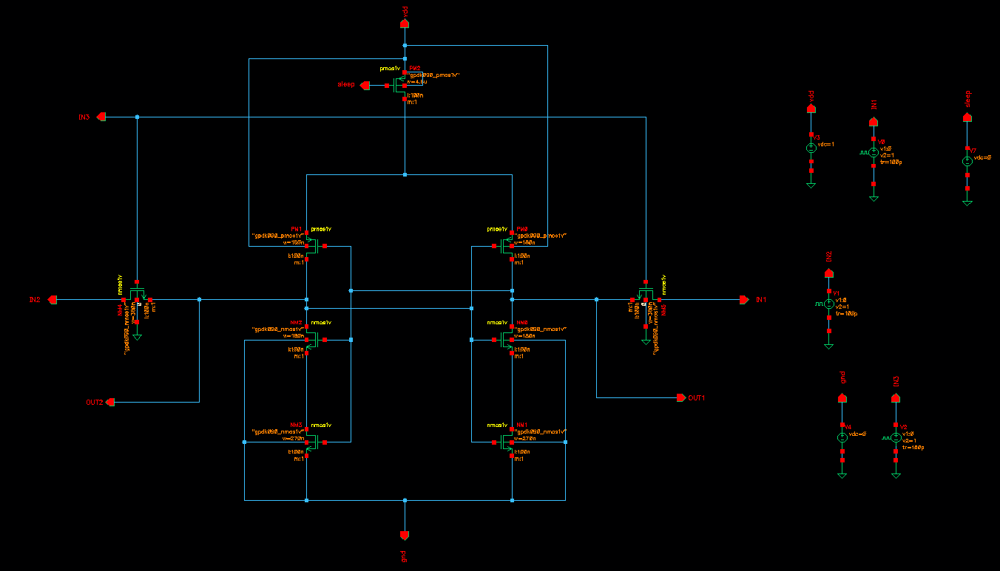
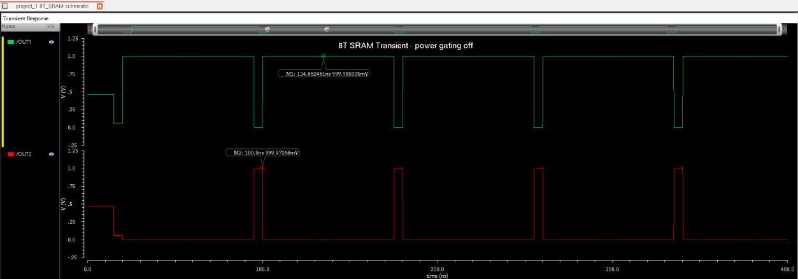
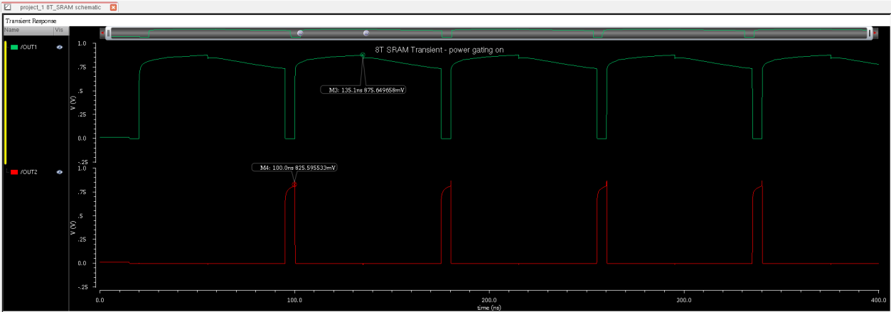
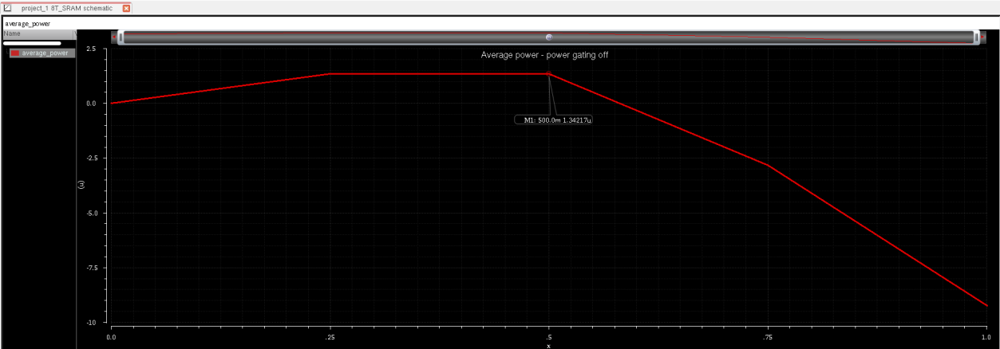
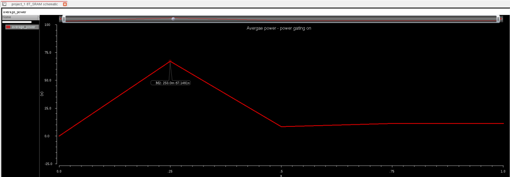
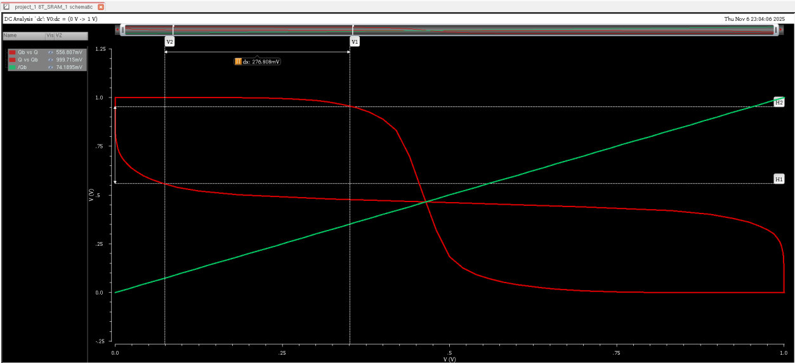

# 🔋 Low-Power 8T SRAM with Power Gating (90 nm CMOS)


A **low-power 8T Static Random Access Memory (SRAM) cell** that adds a **power-gating (sleep transistor)** scheme to cut standby leakage. The cell is designed and simulated in **Cadence Virtuoso** using the **GPDK 90 nm** CMOS process at **VDD = 1 V**, and it is compared with and without power gating across transient, temperature, power and noise-margin analyses.

This README explains the project topic by topic, from the motivation and circuit topology to device sizing, simulation setup and results.

---

## Table of Contents

1. [Project Overview](#1-project-overview)
2. [Background and Motivation](#2-background-and-motivation)
3. [The 8T SRAM Topology](#3-the-8t-sram-topology)
4. [The Power-Gating Concept](#4-the-power-gating-concept)
5. [Design Objectives and Metrics](#5-design-objectives-and-metrics)
6. [Simulation Setup](#6-simulation-setup)
7. [Testbench Stimuli](#7-testbench-stimuli)
8. [Device Sizing](#8-device-sizing)
9. [Schematic](#9-schematic)
10. [Results](#10-results)
    - [10.1 Transient Analysis](#101-transient-analysis)
    - [10.2 Delay vs Temperature](#102-delay-vs-temperature)
    - [10.3 Average Power Comparison](#103-average-power-comparison)
    - [10.4 Butterfly Curve and Read SNM](#104-butterfly-curve-and-read-snm)
11. [Discussion and Analysis](#11-discussion-and-analysis)
12. [Results Summary](#12-results-summary)
13. [Scope and Limitations](#13-scope-and-limitations)
14. [Future Work](#14-future-work)
15. [Suggested Repository Structure](#15-suggested-repository-structure)
16. [How to Reproduce](#16-how-to-reproduce)
17. [References](#17-references)
18. [Team](#18-team)

---

## 1. Project Overview

As semiconductor technology scales down, **leakage power** becomes a dominant part of SRAM power consumption, especially in large caches that sit idle most of the time. This project designs an SRAM cell that attacks the problem on two fronts:

- an **8T cell** with separate read and write paths, which keeps the stored data safe during reads, and
- a **power-gating sleep transistor**, which cuts the leakage path while the cell is in standby.

**Highlights**

| | |
|---|---|
| Cell type | 8T SRAM with power gating |
| Technology | GPDK 90 nm CMOS |
| Supply | 1.0 V |
| Tool | Cadence Virtuoso |
| Average power | 1.3421 µW (gating OFF) to 64.1481 nW (gating ON), about **95% lower** |
| Read static noise margin | **276.808 mV** |
| Temperature sweep | −40 °C to 125 °C |

---

## 2. Background and Motivation

The conventional **6T SRAM** cell is popular because it is small and dense, but below roughly 100 nm it runs into several problems:

- **Read disturb.** During a read, a storage node is connected to the bitline through an access transistor, so the stored data can be corrupted.
- **Rising leakage.** Subthreshold and gate-oxide leakage grow as devices shrink, which hurts standby power in rarely accessed arrays.
- **Shrinking noise margins**, which reduce reliability at low supply voltages.

Alternative cells such as **7T** and **8T** add transistors to improve read stability. The **8T cell** goes furthest by giving the read operation its own dedicated path. Even so, leakage remains an issue, which is why **power gating** is added on top.

The resulting cell balances **performance, stability and energy**, which suits power-limited applications such as mobile devices, IoT nodes and biomedical electronics.

---

## 3. The 8T SRAM Topology

The cell has three functional parts.

### 3.1 Storage latch
Two **cross-coupled CMOS inverters** (a pair of PMOS pull-ups and a pair of NMOS pull-downs) hold the data bit, either `0` or `1`.

### 3.2 Write path
Two **NMOS write-access transistors**, controlled by the **Word Line (WL)**, connect the internal storage nodes to the bitlines **BL** and **BLB**.
- To write **1**: drive BL = 1 and BLB = 0.
- To write **0**: drive BL = 0 and BLB = 1.

### 3.3 Read path (the extra two transistors)
Two additional **NMOS transistors** form an independent read path, controlled by the **Read Word Line (RWL)** and sensed on the **Read Bitline (RBL)**:
1. RBL is **pre-charged**.
2. RWL is asserted.
3. RBL is **conditionally discharged** depending on the stored data.

Because the read path only *senses* the storage node and never connects the node to a bitline, the internal nodes are **not disturbed** during a read. This gives a large **Read Static Noise Margin (RSNM)** and allows operation at lower supply voltages.

| Operation | Controlled by | Path used |
|---|---|---|
| Write | WL, BL, BLB | Write-access transistors |
| Read | RWL, RBL | Dedicated read transistors |
| Hold / standby | SLEEP | Sleep transistor |

---

## 4. The Power-Gating Concept

**Power gating** inserts a **high-threshold sleep transistor** between the SRAM cell and its supply path (a *virtual rail*). The transistor is controlled by a signal called **SLEEP**.

- **Active mode:** the sleep transistor is on, the virtual rail is at full level, and the cell reads and writes normally with only a small voltage drop.
- **Standby mode:** the sleep transistor is turned off, the virtual rail floats to an intermediate level, and the **leakage paths through the cell are cut**, which strongly reduces subthreshold and gate-oxide leakage. The voltage across the storage nodes stays above the **data-retention threshold**, so the bit is kept.

**Sleep transistor sizing is a trade-off**

| If the sleep transistor is... | Effect |
|---|---|
| **Too small** | Higher IR drop and slower operation |
| **Too large** | More area and more dynamic switching energy |

In this design the sleep transistor is deliberately wider than the other devices (4800 nm against 180 to 360 nm), so that it adds very little resistance in active mode.

---

## 5. Design Objectives and Metrics

**Primary goal:** minimise standby leakage while keeping adequate speed, stability and functional reliability across temperature.

| Parameter | Symbol | Description | Unit | Target |
|---|---|---|---|---|
| Supply voltage | VDD | Operating voltage | V | 1 |
| Standby power | P_standby | Power during sleep mode | µW | Minimum |
| Active power | P_active | Power during operation | µW | Low |
| Read delay | T_read | Time from WL high to BL/BLB differential | ps | < 300 |
| Write delay | T_write | Time for a node to reach its logic level | ps | < 300 |
| Read SNM | V_RSNM | Read static noise margin | mV | High |
| Read energy | E_read | Energy to read 1 bit | fJ | Minimum |
| Write energy | E_write | Energy to write 1 bit | fJ | Minimum |

**Design objectives**

1. **Reduce leakage.** Use a high-threshold sleep transistor and quantify the standby-power reduction against the non-gated 8T cell.
2. **Optimise delay.** Measure read and write delay with gating ON and OFF, and judge the effect of sleep-transistor resistance and wake-up time.
3. **Temperature dependence.** Measure delay and power from −40 °C to 125 °C.
4. **Stability.** Compute RSNM from the butterfly curve in active and gated modes.
5. **Dynamic power.** Compare average power over a read/write cycle with and without gating.
6. **Area and sizing efficiency.** Tune W/L ratios for the best trade-off between leakage, delay and stability.

---

## 6. Simulation Setup

| Item | Value |
|---|---|
| Tool | Cadence Virtuoso (schematic and simulation) |
| Process | GPDK 90 nm |
| Corner | Typical (TT) |
| Supply voltage | 1.0 V |
| Channel length | L = 100 nm for all transistors |
| Control signal | SLEEP switches between active and sleep states |
| Analyses | Transient, DC (butterfly curve / SNM), parametric temperature sweep, average power |

---

## 7. Testbench Stimuli

A separate **testbench schematic** drives WL, BL, BLB and SLEEP with pulsed voltage sources, with edge timing chosen so that the write and read operations are exercised in sequence.

| Signal | Source type | Voltage | Period | Delay | Rise time | Fall time |
|---|---|---|---|---|---|---|
| Vdd | DC | 1 V | - | - | - | - |
| Gnd | DC | 0 V | - | - | - | - |
| Sleep | DC | 1 / 0 | - | - | - | - |
| IN1 (WL) | Pulse | 0 to 1 | 80 ns | 15 ns | 100 ps | 100 ps |
| IN2 (W/R') | Pulse | 0 to 1 | 80 ns | 20 ns | 100 ps | 100 ps |
| IN3 (BLB) | Pulse | 0 to 1 | 80 ns | 60 ns | 100 ps | 100 ps |

---

## 8. Device Sizing

All devices use **L = 100 nm**. Sizing was refined by iterating **voltage transfer characteristics (VTC)** and **SNM curves** to obtain symmetrical switching points and good stability.

| Transistor | Type | Function | Width (nm) | Length (nm) |
|---|---|---|---|---|
| M1 | PMOS | Sleep (power-gating) transistor | 4800 | 100 |
| M2, M3 | PMOS | Pull-up transistors | 180 | 100 |
| M4, M5 | NMOS | Pull-down transistors | 180 | 100 |
| M6, M7 | NMOS | Write-access transistors | 270 | 100 |
| M8, M9 | NMOS | Read-port transistors | 360 | 100 |

**Sizing rationale**
- **Pull-down NMOS stronger than pull-up PMOS**, for faster discharge in read and write operations.
- **Access transistors sized** so that writes succeed without compromising stability.
- **Sleep transistor much wider** (about 27× the pull-up width) to limit IR drop in active mode, while not being so wide that area and switching energy grow excessively.

---

## 9. Schematic

<p align="center">
  
</p>

*Figure 1: 8T SRAM schematic with separate read and write paths.*

The schematic shows the cross-coupled inverters in the centre, the write-access transistors on the left and right driven by the bitlines, the dedicated read transistors, and the sleep transistor controlling the supply path at the top, together with the voltage sources of the testbench.

---

## 10. Results

### 10.1 Transient Analysis

Write and read operations were simulated in two cases: **power gating OFF** (normal 8T SRAM) and **power gating ON** (low-power configuration).

<p align="center">
  
</p>

*Figure 2(a): Transient analysis, power gating OFF.* The outputs show clean, full-swing transitions (close to 1 V). The write cycle stores the data from BL/BLB in the cross-coupled inverters, and the read cycle then produces clear logic transitions on the read bitline.

<p align="center">
  
</p>

*Figure 2(b): Transient analysis, power gating ON.* Reading and writing still work correctly. The output high level is slightly lower (the markers read roughly 0.83 to 0.88 V), which reflects the small voltage drop across the sleep transistor. The leakage current through the cell stack is sharply reduced because the discharge path is cut.

**Takeaway:** read, write and data retention work in **both** modes.

### 10.2 Delay vs Temperature

<p align="center">
  
</p>

*Figure 3: Read delay vs temperature.* Read delay is measured from the rising edge of WL to the 50% crossing of the BL/BLB differential output. In the plot, the delay climbs with temperature and peaks near **70 °C**, which matches the expected trend of reduced carrier mobility slowing the transistors at higher temperature. The gated design works reliably without functional error, and the small delay change confirms that the sleep transistor adds negligible resistance when active.

### 10.3 Average Power Comparison

Average power was computed by transient energy integration, covering one full write-read cycle in active mode and a long idle period in standby.

<p align="center">
  
</p>

*Figure 4(a): Average power, power gating OFF.*

<p align="center">
  
</p>

*Figure 4(b): Average power, power gating ON.*

| Mode | Average Power (Peak) |
|---|---|
| Power gating OFF | **1.3421 µW** |
| Power gating ON | **64.1481 nW** |

Without gating, the standby current through the pull-down and access transistors makes up most of the power. With gating, the sleep transistor cuts these leakage paths and average power drops by about **95%** (1 − 64.1481 nW / 1.3421 µW ≈ 0.952).

### 10.4 Butterfly Curve and Read SNM

<p align="center">
  
</p>

*Figure 5: Butterfly curve and static noise margin.*

The **butterfly curve** is built by plotting the voltage transfer characteristics of the two cross-coupled inverters and mirroring one about the Vout = Vin line. The largest square that fits inside the two lobes gives the **Read Static Noise Margin**, measured here as **276.808 mV**, which shows strong tolerance to noise and voltage fluctuation.

---

## 11. Discussion and Analysis

- **Functionality.** Read, write and retention all work with power gating ON and OFF, and the internal nodes keep their state during gated standby.
- **Leakage savings.** Average power falls by about 95%, which is a major gain for memory blocks that stay unchanged for long periods.
- **Speed.** Read delay follows the expected temperature trend, and the sleep transistor adds little delay penalty.
- **Stability.** The isolated read path of the 8T cell protects the storage nodes, so RSNM and write margins stay close to the non-gated 8T cell even with the gating circuit present. The small margin reduction (about 1 to 2%) is acceptable.
- **Temperature robustness.** The circuit remains stable and functional up to 125 °C, which suggests it is suitable for wide-temperature applications such as automotive and industrial systems.

**Where it fits:** IoT devices, portable and mobile processors, biomedical electronics and other energy-constrained embedded systems.

---

## 12. Results Summary

| Metric | Result |
|---|---|
| Technology / supply | GPDK 90 nm, VDD = 1 V, L = 100 nm |
| Average power, gating OFF | 1.3421 µW |
| Average power, gating ON | 64.1481 nW |
| Power reduction | ≈ **95%** |
| Read static noise margin | **276.808 mV** |
| Delay behaviour | Increases with temperature (peak near 70 °C in the plot) |
| Temperature range | −40 °C to 125 °C |
| Functionality | Read, write and retention verified with gating ON and OFF |

---

## 13. Scope and Limitations

To keep the project honest and reproducible, note the following:

- **Schematic-level only.** Results do not include layout parasitics (capacitance and resistance of wiring), so real silicon numbers would differ.
- **Single cell.** Bitline loading, wordline delay and array effects are not covered.
- **Typical corner only.** Process corners (SS, FF and so on) and Monte-Carlo variation were not part of this study.
- **Gated-mode figures** are taken from the simulation plots as presented in the project report.

---

## 14. Future Work

1. **Post-layout simulation and parasitic extraction.** Draw the layout in Virtuoso and re-run the analyses with parasitics for more realistic delay, power, stability and area.
2. **Array-level integration.** Scale to a 4×4 or 8×8 array to study bitline loading, wordline delay, row-level leakage control and shared power gating.
3. **Dynamic power-gating control.** Control the sleep transistor based on workload or access frequency, minimising unnecessary wake-up transitions.
4. **Technology scaling.** Repeat the study at 65 nm, 45 nm or with FinFETs to see how leakage, gate control and temperature sensitivity change.

---

## 15. Suggested Repository Structure

```
low-power-8t-sram-power-gating/
├── schematics/          # Virtuoso schematic screenshots / exported views
├── simulation/          # Testbench setups, ADE / Maestro states, result plots
├── docs/                # Project report (PDF)
├── assets/              # Images used in this README
└── README.md
```

*Adjust to match your actual files. Add the project report PDF under `docs/`.*

---

## 16. How to Reproduce

1. Open Cadence Virtuoso and create a library using the **GPDK 90 nm** PDK.
2. Draw the 8T cell and the sleep transistor using the sizes in [Section 8](#8-device-sizing).
3. Build the testbench with the sources in [Section 7](#7-testbench-stimuli), at VDD = 1 V.
4. Run **transient analysis** for gating OFF (normal operation) and gating ON (SLEEP configured for low-power mode).
5. Run a **parametric temperature sweep** from −40 °C to 125 °C and measure read delay from WL rising to the 50% crossing of the BL/BLB differential.
6. Compute **average power** by integrating transient energy over a write-read cycle and an idle period.
7. Run a **DC analysis** of the two inverters' VTCs and mirror one curve to obtain the butterfly plot and read the SNM.

---

## 17. References

1. S. L. M. Hassan, I. Dayah, and I. S. A. Halim, "Comparative study on 8T SRAM with different type of sense amplifier," *Proc. IEEE ICSE 2014*, Kuala Lumpur, Malaysia, pp. 321–324, 2014.
2. D. Kakde and L. V. Birgale, "Power optimization in 8T SRAM cell," *Proc. IEEE Conf. on Recent Advances and Innovations in Engineering (RAIE)*, Nanded, India, 2014.
3. A. S. Anusha, B. S. Nikhil, K. S. Manoj, and K. S. Pande, "MTCMOS 8T SRAM cell with improved stability and reduced power consumption," *Proc. IEEE DISCOVER*, Bengaluru, India, pp. 242–247, 2021. doi: 10.1109/DISCOVER52564.2021.9663628

---

## 18. Team

| Name |
|---|
| Tarun Rithvik B |
| Krithik B |
| Mohammad Oomar Farooq S |
| **Rajeswaran K** |

- 💼 [LinkedIn](https://www.linkedin.com/in/rajeswaran-k-4712a1317)
- 📧 [rajeswarank333@gmail.com](mailto:rajeswarank333@gmail.com)
